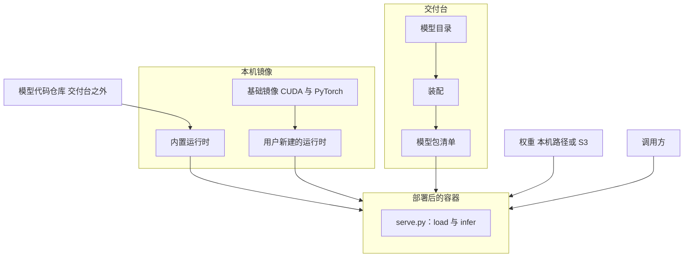
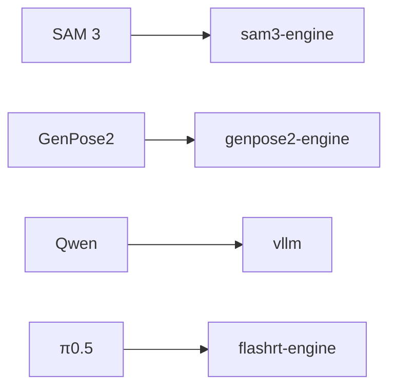
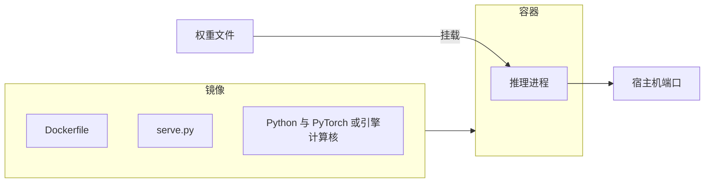
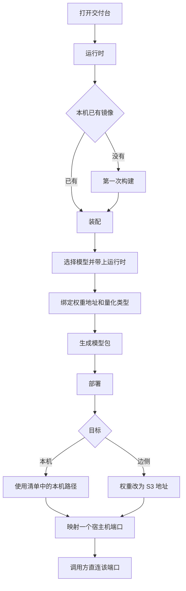
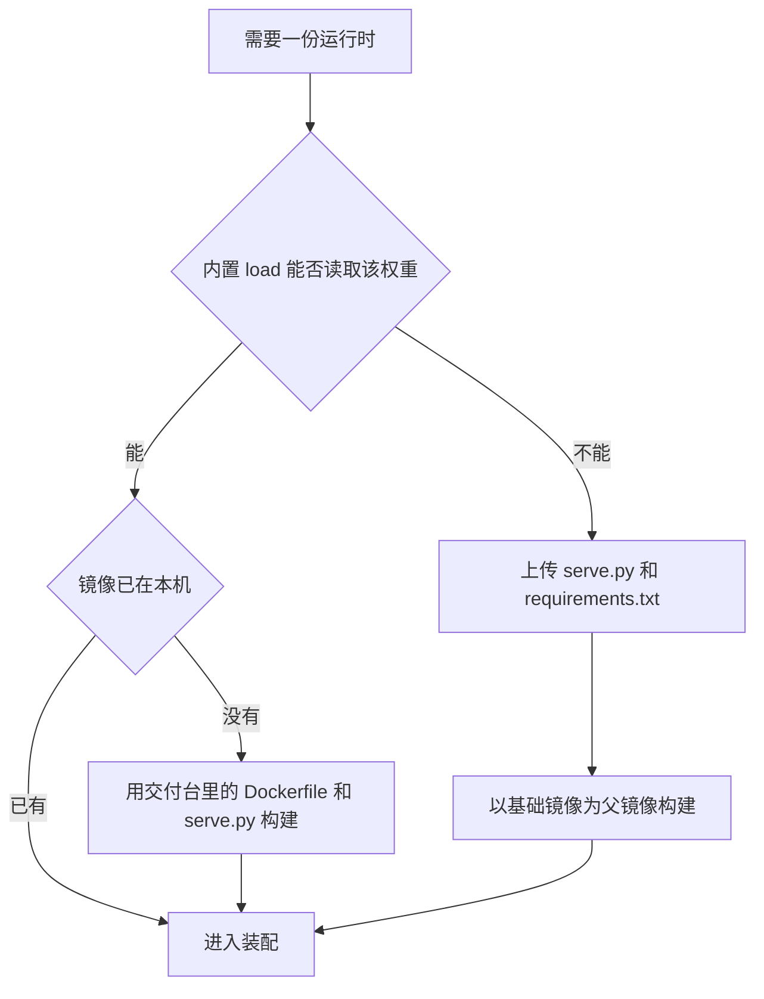
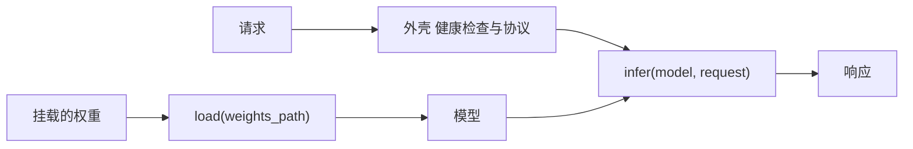
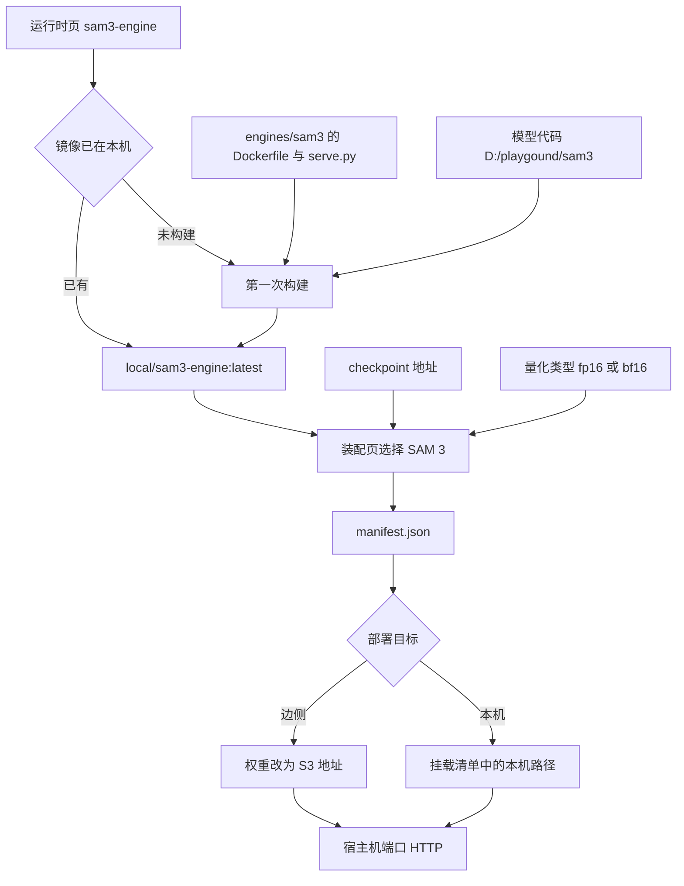
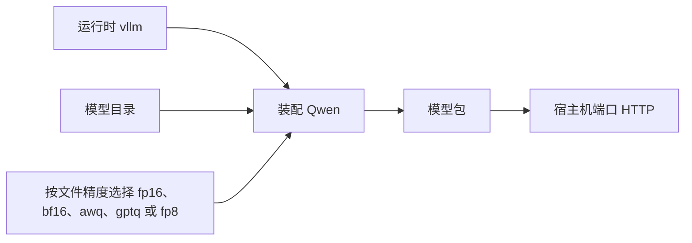
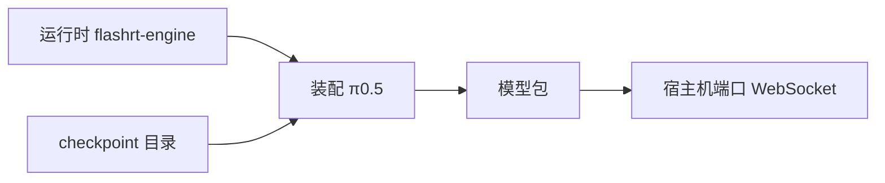
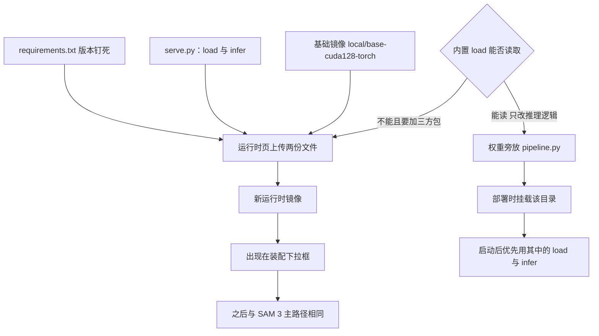

# 具身模型交付台

给具身场景的模型做一份可部署清单。清单记下用哪个模型、哪份运行时、权重在哪。镜像、服务代码和权重文件都不进清单目录。

页面顺序按实际操作：运行时、装配、模型包、部署。打开后仍停在装配。

打包机和推理机可以是同一台。同一台时用本机镜像和本机路径，不需要镜像仓库。部署到边侧时，权重要改用 S3 地址。本机路径只在打包这台机器上有效。

交付台不加载模型，不做量化，不把权重打进镜像。量化、打包后的特殊格式、整数计算核，都在对应运行时的 `load` / `infer` 里完成。

## 整体架构

交付台只产生清单和镜像。推理发生在部署出来的容器里，调用方直接连该容器映射到宿主机的端口。



内置运行时和模型的对应关系：



容器内部只有服务代码和挂载进来的权重。镜像在构建时已经包含 `serve.py` 和依赖，权重不在镜像层里。



## 流程图

交付主路径。装配不触发构建；镜像已经在本机时，运行时这一步直接跳过。



运行时的来源。内置引擎能加载就用内置镜像；不能加载才从基础镜像新建。



`serve.py` 在容器里的调用顺序：



## 交付时发生什么

| 步骤 | 做什么 | 留下什么 |
| --- | --- | --- |
| 运行时 | 使用内置运行时，或从基础镜像构建一份新运行时。本机已有该镜像则跳过。 | 本地镜像，例如 `local/sam3-engine:latest` |
| 装配 | 选定模型后带上它的运行时。同一模型有多份运行时时再下拉选择。只绑定权重地址，并标明量化类型。 | 一份模型包目录 |
| 模型包 | 查看清单。清单不复制大文件。 | `data/packages/<id>/manifest.json` |
| 部署 | 用已有镜像启动容器，按清单挂载权重，把容器端口映射到宿主机的一个端口。 | 一个可直接访问的推理进程 |
| 调用 | 客户端直接连这个宿主机端口。 | HTTP 或 WebSocket，由该运行时的协议决定 |

装配页选择模型不会触发构建。第一次构建只从运行时页进入。

## 用户旅程

使用的人是在这台机体上交付模型的工程师。目标是选出运行时、绑好权重，得到一份能在本机或边侧跑起来的模型包。

### 主路径：用内置运行时交付 SAM 3

1. 打开交付台，进入运行时。看到 sam3-engine。本机还没有镜像时，状态是「未构建」，点「第一次构建」。
2. 构建使用 `engines/sam3` 里的 `Dockerfile` 和 `serve.py`，并把已经 clone 在 `D:\playgound\sam3` 的模型代码装进 `local/sam3-engine:latest`。权重不进镜像。镜像已在本机则跳过这一步。
3. 进入装配，选择 SAM 3。页面带上 sam3-engine 的镜像、命令和端口，不发起构建。
4. 填写包名称，绑定 checkpoint 地址，量化类型选 `fp16` 或 `bf16`。这个类型必须是文件本身的精度，并且落在该运行时声明的 `weightQuants` 里。
5. 生成模型包。目录里只有 `manifest.json`，权重仍留在原路径或 S3。
6. 在部署页选择这份包。目标是本机时直接用清单里的路径；目标是边侧时，权重必须已经是 S3 地址。部署使用已有镜像，不再构建。
7. 调用直接连部署时映射出来的宿主机端口。SAM 3 走 HTTP。



### 分支：Qwen 用 vLLM

运行时选 vllm，不选一份单独的 Qwen 镜像。装配 Qwen 时绑定模型目录，并按文件实际精度选择 `fp16`、`bf16`、`awq`、`gptq` 或 `fp8`。vLLM 按权重目录里的量化配置加载。文件仍是 fp16、只是加载时再压低精度的，`quant` 仍标 `fp16`。



### 分支：π0.5 用 FlashRT

没有单独的 pi05-engine。装配 π0.5 时运行时是 flashrt-engine，协议是 WebSocket，容器端口 8000，权重是一个 checkpoint 目录。调用直接连部署时映射出来的宿主机端口。



### 分支：自建运行时

内置运行时的 `load` 读不了目标模型时，工程师在运行时页选择基础镜像 `local/base-cuda128-torch:latest`，上传两份文件：实现了 `load` 和 `infer` 的 `serve.py`，以及钉死版本的 `requirements.txt`。交付台以这张基础镜像为父镜像构建新镜像，不把权重打进去，也不改 SAM 3、GenPose2、vLLM、FlashRT。构建完成后，新运行时出现在装配页的下拉框里，后面的装配、模型包和部署与主路径相同。边侧没有外网时，只能选用已经构建好的运行时。

只改推理逻辑、不增加三方包时，不必新建运行时。把 `pipeline.py` 放在权重旁边，部署时挂载该目录，启动后优先使用其中的 `load` 和 `infer`。



## 四个对象

| 对象 | 是什么 | 和别的对象怎么分 |
| --- | --- | --- |
| 模型 | SAM 3、GenPose2、π0.5、Qwen 这类身份：任务、输入输出、要绑哪些权重。 | 换一套权重身份就是另一个模型。加载方式必须和运行时的 `load` 对得上。 |
| 运行时 | 镜像、`serve.py`、启动命令、容器端口、协议、健康检查。另外声明能加载哪些模型、能读哪些权重精度。界面上的运行时就是引擎。 | 一份运行时可以服务多个模型，只要同一套 `load` 能读这些权重。YOLO 和 SAM 3 各用各的运行时。 |
| 模型包 | `manifest.json`，apiVersion 为 `aiserver.modelpackage/v1`。 | 记下模型、运行时和权重地址。不复制大文件，也不复制源码。 |
| 部署 | 在本机或边侧把这份清单跑起来。 | 部署时不再构建。镜像已经在目标环境里，或者边侧事先备好同一张镜像。 |

目录里现在仍是一个模型嵌一份引擎。界面按镜像把运行时归在一起。同一模型再挂一份运行时，装配页出现下拉框。命令、端口、协议、健康检查跟着运行时走，不在装配里改。

## 运行时分两种

### 内置运行时

交付台提供完整引擎。每种有自己的镜像、`Dockerfile`、`serve.py`，以及能读的权重类型。镜像由交付台构建一次，用户不修改其中的文件。

| 运行时 | 镜像 | 谁用 | 状态 |
| --- | --- | --- | --- |
| sam3-engine | `local/sam3-engine:latest` | SAM 3 图像与文本分割 | `engines/sam3` 已有 `Dockerfile` 和 `serve.py` |
| genpose2-engine | `local/genpose2-engine:latest` | GenPose2 的 6D 位姿 | `engines/genpose2` 已有 `Dockerfile` 和 `serve.py`。构建需要本机的 GenPose2 代码 |
| vllm | `local/vllm-engine:latest` | Qwen 一类语言模型。按权重目录里的量化配置加载 fp16、bf16、awq、gptq、fp8 | `engines/vllm` 已有 `Dockerfile` 和 `serve.py` |
| flashrt-engine | `local/flashrt-engine:latest` | π0.5 的部署。WebSocket，容器端口 8000，权重是一个 checkpoint 目录。自带计算核，不通过 `requirements.txt` 安装 | `engines/flashrt` 已有 `Dockerfile` 和 `serve.py`。构建需要本机的 FlashRT 目录 |

某份内置运行时的 `load` 已经能读目标权重时，直接装配，不必再上传代码。vLLM、FlashRT 的计算核在各自镜像里，不通过后面的 `requirements.txt` 安装。

模型仓库仍在交付台外各 clone 一次。SAM 3 的模型代码在 `D:\playgound\sam3`，官方仓库不提供本平台的 `Dockerfile` 和 `serve.py`。构建 SAM 3 时，在交付台仓库根目录执行：

```text
docker build -f engines/sam3/Dockerfile --build-context sam3=D:\playgound\sam3 -t local/sam3-engine:latest engines/sam3
```

该命令把本机模型代码装进镜像。权重不在构建上下文里。

### 基础镜像

基础镜像只提供 CUDA、Python 和 PyTorch，不含某个模型的推理代码，也不含权重。第一张基础镜像面向 CUDA 12.8：

| 基础镜像 | 内容 |
| --- | --- |
| `local/base-cuda128-torch:latest` | NVIDIA CUDA 12.8 运行库、Python、PyTorch CUDA 12.8。启动命令 `python serve.py`，HTTP，容器端口 8080，健康检查 `/health` |

容器里的 CUDA 可以低于宿主机驱动所支持的最高版本，驱动必须支持该镜像里的 CUDA。昇腾不能使用这张 CUDA 基础镜像，需要另一张基础镜像。

PyTorch 和 CUDA 来自基础镜像。`requirements.txt` 只追加这张镜像里还没有的 Python 三方包，不更换 PyTorch 或 CUDA。

### 用户新建运行时

内置运行时装不下的推理逻辑，从基础镜像长出一条新运行时。用户上传两份文件：

- `serve.py`：实现 `load(weights_path)` 和 `infer(model, request)`，并按所选基础镜像的端口、协议和健康检查对外服务。运行时页可以下载参考样例 `frontend/public/samples/serve.py`，改里面的 `load` 和 `infer` 后再上传。
- `requirements.txt`：要追加安装的 Python 三方包，版本钉死。

构建时以基础镜像为父镜像，安装这份依赖清单，放入 `serve.py`。挂载的权重和临时文件不打进去。启动命令、端口、协议、健康检查沿用基础镜像。

```text
FROM local/base-cuda128-torch:latest
COPY requirements.txt serve.py /opt/engine/
RUN python -m pip install --no-cache-dir -r /opt/engine/requirements.txt
WORKDIR /opt/engine
CMD ["python", "serve.py"]
```

产物是一条新的本地镜像，例如 `local/user-<id>:latest`。它出现在装配页的下拉框里。内置运行时的镜像不动。边侧没有外网时，只能使用已经构建好的运行时。

## serve.py 的约定

每份运行时的服务入口都是 `serve.py`，目录里的启动命令是 `python serve.py`。镜像里固定两层：外壳负责启动、健康检查和收发请求；`load` 和 `infer` 负责读权重和做推理。

- `load(weights_path)` 按部署时挂进来的权重路径加载模型。SAM 3 从该路径读 checkpoint，不在加载时访问网络下载权重。
- `infer(model, request)` 做推理并返回结果。输出字段由这个函数决定。

SAM 3 当前实现接受图像的 base64 和文本概念，返回分数、框和掩码 PNG。视频请求会拒绝。健康检查是 `GET /health`。推理入口是 `POST /infer`。权重路径默认 `/weights/checkpoint`，可用环境变量 `WEIGHTS_PATH` 覆盖。端口默认 8080，可用 `PORT` 覆盖。

只改加载和推理、不增加安装包时，可以把同样两个函数放在权重旁边，例如 `pipeline.py`。部署挂载该目录。启动时发现它就用它，没有则用镜像里的默认 `serve.py`。这条路不能引入镜像里没有的三方包。缺包时走上一节的新建运行时，不在容器启动时临时安装。

## 权重和量化

交付台只登记权重地址和量化类型，不读取权重内容，也不在构建或部署时做量化。

运行时声明两份能力：

- `models`：这套 `load` 能加载的模型。
- `weightQuants`：能直接读的权重精度。取值范围是 `fp16`、`bf16`、`int8`、`awq`、`gptq`、`fp8`。

模型包写在被绑定的那份权重上，字段为 `quant`。一个包里有多份权重时，每份各自标。CAD 这类附件不标量化类型。装配时校验：包的模型在运行时的 `models` 里，且 `quant` 在 `weightQuants` 里。对不上就不能生成模型包。

`quant` 必须是这份权重文件本身的精度。普通 fp16 / bf16 checkpoint 标 `fp16` 或 `bf16`。已经打成 AWQ 的目录才标 `awq`。交付台不打开文件核对，标错时模型包仍能生成，引擎加载时才会失败。

当前目录中的声明：

| 运行时 | 支持的权重精度 |
| --- | --- |
| SAM 3、GenPose2、FlashRT（π0.5） | `fp16`、`bf16` |
| Qwen 所使用的 vLLM 运行时 | `fp16`、`bf16`、`awq`、`gptq`、`fp8` |

精度文件从哪里来，由引擎侧的工具在上线前完成，例如 LLM Compressor、GPTQModel、NVIDIA Model Optimizer、llama.cpp。交付台不集成这些工具。

有些引擎会在 `load` 时把 fp16 权重压进显存，例如 bitsandbytes、vLLM 的在线 FP8。这时文件本身仍标 `fp16`。能否在加载时量化，是运行时的能力，不写进权重文件的 `quant`。

激活量化不在这一步。它发生在每次 `infer` 的前向里，缩放系数要提前跟量化权重放在一起。默认 `infer` 已经会用这些系数时，只改绑权重；否则换 `serve.py` 或换带整数核的内置运行时。

## 模型包

清单只有四段。以「车间分割」这种包为例：

| 段落 | 记下的内容 | 不放进包目录的东西 |
| --- | --- | --- |
| metadata | 名称、版本、说明、生成时间 | 打包过程的日志 |
| model | 模型 id、显示名、任务、输入输出 | 模型源码 |
| engine | 镜像名、服务代码位置、启动命令、端口、协议、环境变量、GPU 和内存、`models`、`weightQuants` | 镜像层本身 |
| weights | 角色、来源、地址、大小、校验值、`quant`。来源可以是本机路径、上传文件或 S3 | 权重文件本体 |

超过 64MB 的文件跳过校验值计算。上传只接受权重文件，不在上传时创建运行时。自定义运行时可以手写模型 id；目录里没有的 id 会作为自定义模型出现在装配页，并绑定一份权重。

当前四个模型：

| 模型 | 运行时镜像 | 协议和容器端口 | 权重要求 |
| --- | --- | --- | --- |
| SAM 3 | `local/sam3-engine:latest` | HTTP · 8080 | 一个 checkpoint 文件 |
| GenPose2 | `local/genpose2-engine:latest` | HTTP · 8081 | 主权重；CAD 或先验可选，不标量化类型 |
| π0.5 | `local/flashrt-engine:latest` | WebSocket · 8000 | 一个 checkpoint 目录 |
| Qwen | `local/vllm-engine:latest` | HTTP · 8082 | 含配置、分片和 tokenizer 的模型目录 |

表中的端口是容器内端口。没有单独的 pi05-engine。Qwen 使用 vLLM，不使用单独的 Qwen 镜像。

## 部署

每个模型包对应一个容器。容器内端口沿用运行时的端口，部署时映射到宿主机的一个未被占用的端口。同时跑多份包时，宿主机端口各不相同。客户端直接访问这个宿主机端口，HTTP 或 WebSocket 都连这里。π0.5 的 WebSocket 长连接也直接连到它自己的映射端口。

部署目标可以是本机，也可以是边侧。两边都使用已经构建好的镜像。边侧的权重使用 S3 地址。

## 构建与环境

第一次构建由交付台放到后台任务里。本机已经有这张镜像时，任务直接结束，不再执行 `docker build`。模型代码目录不存在时，任务失败并记下路径，不会假装构建成功。

环境页读取 `docker version`、`nvidia-smi` 和 `npu-smi`，并逐张镜像做 `docker image inspect`。目录里的 GPU 数量和显存仍是手写的。检测到昇腾时不会自动换成昇腾镜像，因为当前基础镜像只有 CUDA 12.8。

## 已经落地的和还在方案里的

| 能力 | 状态 | 现在的行为 |
| --- | --- | --- |
| 模型目录和模型包清单 | 已落地 | `backend/catalog/models.yaml` 提供四个模型。生成包时把当时的运行时抄进 `manifest.json`。 |
| 权重地址 | 已落地 | 本地库、登记本机路径、上传、S3 地址。超过 64MB 的文件跳过校验值计算。 |
| 装配页 | 已落地 | 选模型后自动带上运行时，不跳去构建。命令、端口、服务代码位置不可在装配里改。 |
| 运行时支持的模型和权重，以及包上的量化类型 | 已落地 | 目录里的运行时声明 `models` 和 `weightQuants`。生成包时每份权重写入 `quant`，对不上就拒绝。 |
| SAM 3 服务代码 | 已编写，未构建 | `engines/sam3/Dockerfile` 与 `serve.py` 已在仓库中。构建时还需要本机的 `D:\playgound\sam3`。交付台不会在没有这份代码时假装构建成功。 |
| 第一次构建 | 已落地 | 运行时页进入构建页后才会开始。后台调用 `docker build`。镜像已在本机则跳过。 |
| 部署 | 已落地 | 本机部署映射一个空闲宿主机端口，并挂载权重。权重旁有 `pipeline.py` 时记进部署记录，容器启动后优先使用它。边侧要求 S3，不在本机启动容器。 |
| 其余内置运行时 | 服务代码已编写，镜像未构建 | GenPose2、vLLM、FlashRT 的 `Dockerfile` 和 `serve.py` 在 `engines/` 下。π0.5 使用 flashrt-engine。Qwen 使用 vllm。 |
| 基础镜像上新增运行时 | 已落地 | 运行时页上传 `serve.py` 和 `requirements.txt`，并提供可下载的 `serve.py` 参考样例。生成以 `local/base-cuda128-torch:latest` 为父镜像的 Dockerfile。PyTorch 和 CUDA 不能写进这份依赖清单。基础镜像没有单独的「第一次构建」；构建自定义运行时时，本机还没有基础镜像就会先构建它。 |
| 权重旁的 `pipeline.py` | 已落地 | 各内置 `serve.py` 和用户运行时的入口都会在启动时改用它的 `load` 和 `infer`。不能因此使用镜像里没有的三方包。 |
| 环境感知 | 已落地 | `/api/environment` 报告 Docker、NVIDIA、昇腾，以及每张镜像是否已在本机。 |
